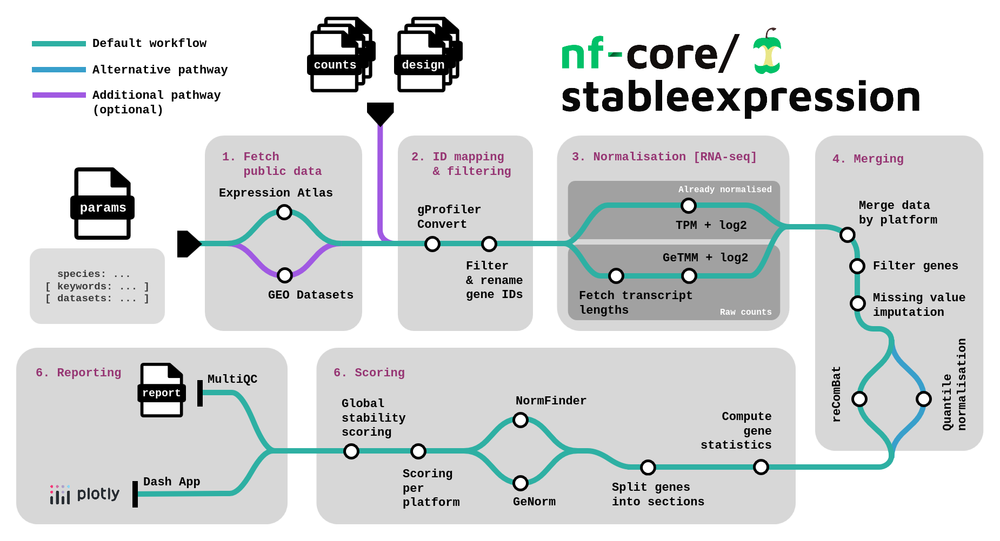

<h1>
  <picture>
    <source media="(prefers-color-scheme: dark)" srcset="docs/images/nf-core-stableexpression_logo_dark.png">
    
  </picture>
</h1>

[](https://github.com/codespaces/new/nf-core/stableexpression)
[](https://github.com/nf-core/stableexpression/actions/workflows/nf-test.yml)
[](https://github.com/nf-core/stableexpression/actions/workflows/linting.yml)[](https://nf-co.re/stableexpression/results)[](https://doi.org/10.5281/zenodo.22895924)
[](https://www.nf-test.com)

[](https://www.nextflow.io/)
[](https://github.com/nf-core/tools/releases/tag/4.1.0)
[](https://apptainer.org/)
[](https://docs.conda.io/en/latest/)
[](https://www.docker.com/)
[](https://sylabs.io/docs/)
[](https://cloud.seqera.io/launch?pipeline=https://github.com/nf-core/stableexpression)

[](https://nfcore.slack.com/channels/stableexpression)[](https://bsky.app/profile/nf-co.re)[](https://mstdn.science/@nf_core)[](https://www.youtube.com/c/nf-core)

## Introduction

**nf-core/stableexpression** is a bioinformatics pipeline that aims to identify the most stable genes in one or more expression datasets. These datasets can be downloaded from public databases such as [EBI Expression Atlas](https://www.ebi.ac.uk/gxa/home) and [NCBI GEO Datasets](https://www.ncbi.nlm.nih.gov/gds), or provided directly by the user. Both RNA-seq and microarray count datasets can be used.

> [!NOTE]
> This pipeline is ideal for identifying the most suitable RT-qPCR reference genes for a given species.

> [!TIP]
> nf-core/stableexpression is available in the [Galaxy Toolshed](https://toolshed.g2.bx.psu.edu/repositories/ab1194062ff0759f). Ask your Galaxy administrator to install it.

<p align="center">
    
</p>

The main inputs are:

- a species name (mandatory)
- keywords for Expression Atlas / GEO search (optional)
- a `YAML` / `CSV` input file listing your own raw / normalised count datasets (optional).

## Pipeline overview

The pipeline is built using [Nextflow](https://www.nextflow.io/) and processes data using the following steps:

#### 1. Get accessions from public databases

- Fetch [Expression Atlas](https://www.ebi.ac.uk/gxa/home) dataset accessions corresponding to the provided species (and optionally keywords). This step is run by default but is optional. Set `--skip_fetch_eatlas_accessions` to skip it.
- Fetch NBCI [GEO](https://www.ncbi.nlm.nih.gov/gds) dataset accessions corresponding to the provided species (and optionally keywords).
  This step is optional and **not** run by default. Set `--fetch_geo_accessions` to run it. ⚠️ Due to the heterogeneous formats of NCBI GEO datasets, the retrieval of expression datasets from NCBI GEO is considered **experimental**. ⚠️

#### 2. Download data (see [usage](./conf/usage.md#3-provide-your-own-accessions))

- Download [Expression Atlas](https://www.ebi.ac.uk/gxa/home) data if any
- Download NBCI [GEO](https://www.ncbi.nlm.nih.gov/gds) data if any

🔌 At this stage, the datasets that have been downloaded from public databases are merged with the user datasets provided using the `--datasets` parameter. See [usage](./conf/usage.md#4-use-your-own-expression-datasets) for more information about user datasets.

#### 3. ID Mapping (see [usage](./conf/usage.md#5-custom-gene-id-mapping--metadata))

- Gene IDs are cleaned.
- Map gene IDS to Ensembl IDs using [`g:Profiler`](https://biit.cs.ut.ee/gprofiler/gost) to standardise gene IDs across datasets (run by default; optional).
- Rare gene IDs are filtered out.

#### 4. Sample filtering

Samples showing too many zeros or missing values are removed from the analysis.

#### 5. Normalisation of RNA-seq datasets

> [!IMPORTANT]
> Whenever possible, RNA-seq data should always be provided raw.

##### Raw RNA-seq data

- Unless provided by the user: download a reference annotation from the Ensembl FTPs ([Ensembl Genomes](https://ftp.ebi.ac.uk/ensemblgenomes/pub/current/) or [Ensembl](https://ftp.ensembl.org/pub/current/)) or using the [NCBI Dataset API](https://api.ncbi.nlm.nih.gov/datasets/v2/).
- Compute the length of the longest transcript for each gene.
- Normalise the raw RNA-seq data using [GeTMM](https://link.springer.com/article/10.1186/s12859-018-2246-7).

##### RNA-seq data already normalised (not recommended)

Already normalised RNA-seq data are converted to TPM (Transcripts Per Million).

> [!NOTE]
> Following normalisation, `log2` is computed on all RNA-seq counts.

#### 6. Data merging & gene filtering

- All the datasets are merged into a single dataframe for each platform (RNA-seq / Microarray).
- Genes with a too high proportion of zeros across samples on a specific platform are filtered out.

#### 7. Imputation of missing values

Missing values are replaced by imputed values using [KNN Imputation](https://scikit-learn.org/stable/modules/generated/sklearn.impute.KNNImputer.html).

#### 8. Scaling / Correction of batch effects

##### Pathway A: ReCombat (default)

Correction of batch effect is performed for each platform separately using [reComBat](https://academic.oup.com/bioinformaticsadvances/article/2/1/vbac071/6728137?login=false).

##### Pathway B: Quantile normalisation

In case reComBat encounters memory issues, quantile normalisation is proposed as a more scalable alternative.

> [!WARNING]
> Please note that quantile normalisation erases the internal structure of the count distributions. Consequently, reCombat is largely preferred over quantile normalisation whenever data fit in memory.

#### 9. General statistics for each gene

Base statistics are computed for each gene, for each platform separately (RNAseq and microarray).

#### 10. Division in sections

The full list of genes is divided into multiple sections based on their expression levels. The genes with the highest expression levels are in section 1, and so on.

#### 11. Scoring

- Run optimised, scalable version of [Normfinder](https://www.moma.dk/software/normfinder).
- Run optimised, scalable version of [Genorm](https://genomebiology.biomedcentral.com/articles/10.1186/gb-2002-3-7-research0034).
- Compute stability score for each gene and for each platform.
- Compute a global stability score for each gene considering all platforms.

#### 12. Reporting

- Result aggregation
- Make [`MultiQC`](http://multiqc.info/) report
- Prepare [Dash Plotly](https://dash.plotly.com/) app for further investigation of gene / sample counts

## Test pipeline

You can test the execution of the pipeline locally with:

```bash
nextflow run nf-core/stableexpression -profile test,<docker/apptainer/conda/micromamba/...>
```

## Basic usage

> [!NOTE]
> If you are new to Nextflow and nf-core, please refer to [this page](https://nf-co.re/docs/get_started/environment_setup/overview) on how to set-up Nextflow. Make sure to [test your setup](https://nf-co.re/docs/get_started/run-your-first-pipeline) with `-profile test` before running the workflow on actual data.

To search the most stable genes in a species considering all public datasets, simply run:

```bash
nextflow run nf-core/stableexpression \
   -profile <PROFILE (docker / apptainer / singularity / conda / micromamba / ...)> \
   --species <SPECIES (examples: arabidopsis_thaliana / "drosophila melanogaster")> \
   --outdir <OUTDIR (example: results)> \
   -resume
```

> [!WARNING]
> Please provide pipeline parameters via the CLI or Nextflow `-params-file` option. Custom config files including those provided by the `-c` Nextflow option can be used to provide any configuration _**except for parameters**_; see [docs](https://nf-co.re/docs/running/run-pipelines#using-parameter-files).

## General usage

For more specific scenarios, such as:

- **fetching datasets related to specific conditions only**
- **using your own expression dataset(s)**

please refer to the [usage documentation](https://nf-co.re/stableexpression/usage).

## Guidelines for selection of RT-qPCR reference (housekeeping) genes

If, like most users, your goal is to find the best candidates as references genes for your RT-qPCR experiments, read the [guidelines for the selection of RT-qPCR reference gene candidates](./docs/rt_pqc_reference_genes.md).

## Resource allocation

For setting pipeline CPU / memory usage, see [here](./docs/configuration.md).

## Profiles

See [here](https://nf-co.re/stableexpression/usage#profiles) for more information about profiles.

## Pipeline output

To see the results of an example test run with a full size dataset refer to the [results](https://nf-co.re/stableexpression/results) tab on the nf-core website pipeline page.
For more details about the output files and reports, please refer to the
[output documentation](https://nf-co.re/stableexpression/output).

## Troubleshooting

In case of issues with the pipeline, please check the [troubleshooting page](./docs/troubleshooting.md) or [report a new issue](https://github.com/nf-core/stableexpression/issues).

## Support us

If you like nf-core/stableexpression, share it to the community and give it a star on GitHub!

[](https://github.com/nf-core/stableexpression)

## Credits

nf-core/stableexpression was originally written and is currently developed by Olivier Coen, first as a personal project and then as a postdoctoral researcher at the [EGCE](https://www.egce.universite-paris-saclay.fr/) ([Université Paris-Saclay](https://www.universite-paris-saclay.fr/), [CNRS](https://www.cnrs.fr/fr)).

We thank the following people for their assistance in the development of this pipeline:

- Rémy Costa
- Gaspard Ichas
- Shaheen Acheche
- Janine Soares

We also thank the following members of the nf-core organisation for their assistance and reviews:

- Simon Pearce
- Quentin Blampey
- Matthias Hörtenhuber
- Phil Ewels
- Maxime U Garcia
- James A. Fellows Yates

## Contributions and Support

If you would like to contribute to this pipeline, please see the [contributing guidelines](docs/CONTRIBUTING.md).

For further information or help, don't hesitate to get in touch on the [Slack `#stableexpression` channel](https://nfcore.slack.com/channels/stableexpression) (you can join with [this invite](https://nf-co.re/join/slack)).

## Citations

If you use nf-core/stableexpression for your analysis, please cite it using the following doi: [10.5281/zenodo.22895924](https://doi.org/10.5281/zenodo.22895924)

An extensive list of references for the tools used by the pipeline can be found in the [`CITATIONS.md`](CITATIONS.md) file.

You can cite the `nf-core` publication as follows:

> **The nf-core framework for community-curated bioinformatics pipelines.**
>
> Philip Ewels, Alexander Peltzer, Sven Fillinger, Harshil Patel, Johannes Alneberg, Andreas Wilm, Maxime Ulysse Garcia, Paolo Di Tommaso & Sven Nahnsen.
>
> _Nat Biotechnol._ 2020 Feb 13. doi: [10.1038/s41587-020-0439-x](https://dx.doi.org/10.1038/s41587-020-0439-x).
