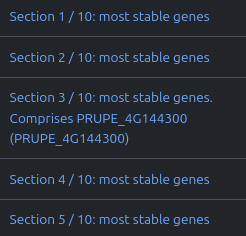

# nf-core/stableexpression: Guidelines for the selection of RT-qPCR reference gene candidates

The `nf-core/stableexpression` pipeline is ideally suited to preselecting high-confidence candidates for use as RT-qPCR housekeeping genes.

Here are some guidelines that will help you find the best reference genes for your experiment.

## Number of reference genes to use

The number of reference genes to use in RT-qPCR is a matter of debate. However, we recommend using at least 3 reference genes, as this will provide a more robust normalisation of your target genes.

Reference papers:
- [The importance of selecting the appropriate reference genes for quantitative real time PCR as illustrated using colon cancer cells and tissue](https://f1000research.com/articles/5-99/v2)

### Specify a target gene

If your goal is to find the best RT-qPCR reference genes with which to normalise the expression of a specific target gene, you may wish to select reference gene candidates whose expression falls within a similar range to that of your target genes.

The parameters `--target_genes` and `--target_gene_file` enable you to provide a list of target genes of interest. This will not affect the pipeline itself, but the MultiQC report will highlight the sections corresponding to the genes of interest, which will facilitate the subsequent selection of candidate reference genes:

    

> [!NOTE]
> To avoid any unrecognised target gene IDs, we recommend that you provide Ensembl gene IDs instead.
